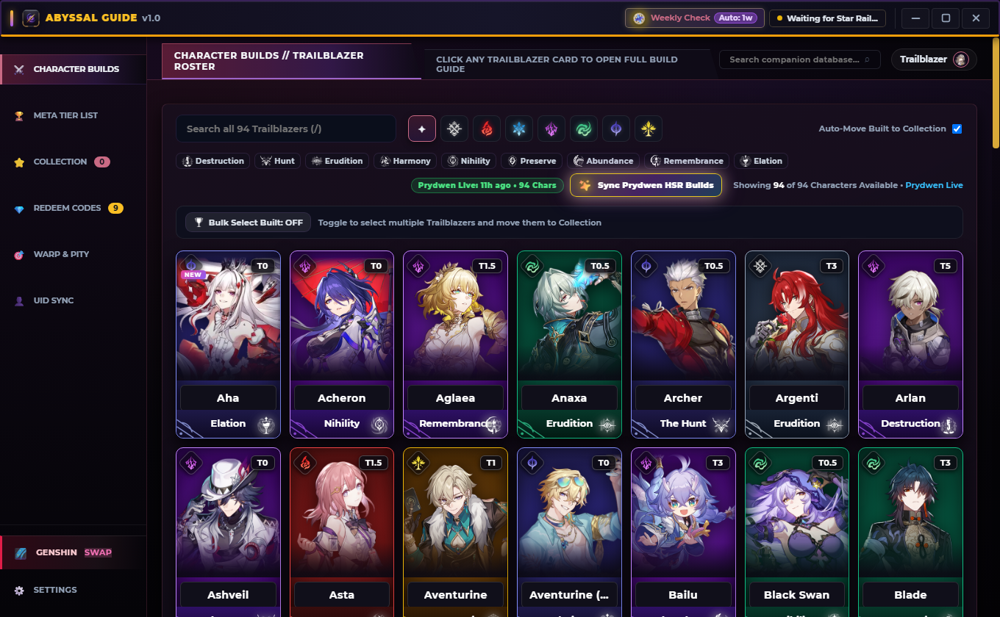

# Abyssal Guide

A lightweight Windows companion app for **Genshin Impact** and **Honkai: Star Rail** so you don't need 10 browser tabs open while playing. Everything stays in one window, swaps between both games in one click, and sits quietly in your system tray when closed.

---

### Genshin Impact

---

### Honkai: Star Rail

---

### What's Inside
- **Character Builds & Teams** — weapons/light cones, artifacts/relics, main stats, substat priority, and team comps.
- **Tier Lists** — live rankings across all endgame modes.
- **Redeem Codes** — active Primogem and Stellar Jade codes with one-click copy and claim tracking.
- **Banners & Pity Tracker** — current/upcoming banners and automatic in-game Wish/Warp history tracking.
- **Bag Scanner & In-Game Overlay** — scan your Genshin inventory (`Alt+I`) or toggle the in-game materials overlay (`Alt+1`).
- **Collection & UID Sync** — track your finished characters or import your public showcase straight from your UID.

### Download & Run
1. Download [**AbyssalGuide-v1.0.1.zip**](https://github.com/Valy166/abyssal-guide/releases/download/v1.0.1/AbyssalGuide-v1.0.1.zip) from [**Releases**](https://github.com/Valy166/abyssal-guide/releases).
2. Extract the folder anywhere on your PC.
3. Open `AbyssalGuide.exe` (when a new update comes out, an **Update** button shows up in the sidebar).

---

Fan-made companion app, not affiliated with HoYoverse. Build and tier data from Prydwen, KeqingMains, and Enka.Network.
