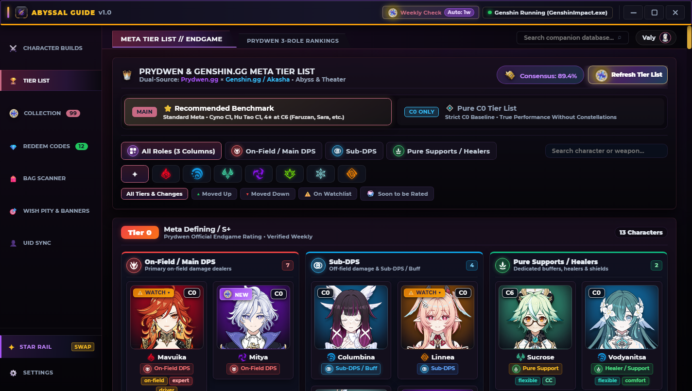
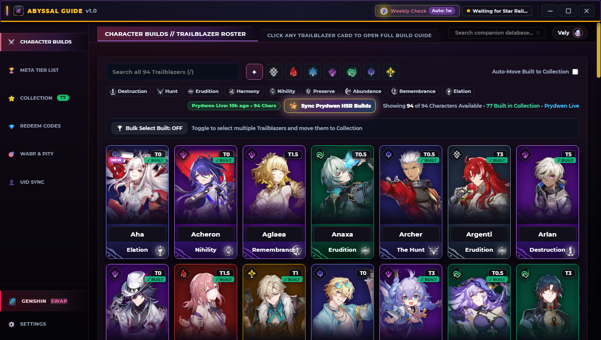

# abyssal guide

lightweight windows desktop companion app for genshin impact and honkai: star rail. keeps character builds, team comps, tier lists, wish/warp pity tracking, redeem codes, and an optional in-game overlay in one window (~16 mb ram in tray).

### download & setup
1. download the latest zip from [**Releases**](https://github.com/Valy166/abyssal-guide/releases/latest) (direct download: [**AbyssalGuide-v1.0.0.zip**](https://github.com/Valy166/abyssal-guide/releases/download/v1.0.0/AbyssalGuide-v1.0.0.zip))
2. extract the folder anywhere on your pc (no installer needed)
3. run `AbyssalGuide.exe`

*(requires windows 10/11 with microsoft edge webview2 runtime, which is already built into almost every windows pc)*

### safety & verification
- since i don't have a paid $200/yr code-signing certificate for a free project, windows smartscreen will show **"unknown publisher"** on first launch — click **More info -> Run anyway**.
- the full app source code (`Program.cs`, `app.manifest`, `public/index.html`, `public/style.css`, `public/app.js`) is open in this repository so you can verify everything the app does.
- every release zip is scanned with windows defender (`0` threats), and the in-app updater verifies release host pinning (`github.com`) + `sha256` checksums before extracting any update.
- `AbyssalGuide.exe` sha256: `2e9b2574363d61a252c13d80578330a25e81cc392a24b897bf68d77822af2788`
- `AbyssalGuide-v1.0.0.zip` sha256: `41c5836be7167742aa995678d3ee1be0124b8b43557d576dca18e8b58883a201`

### disclaimer & credits
- this is a **free, non-commercial fan project** — not affiliated with, endorsed by, or sponsored by **HoYoverse / COGNOSPHERE PTE. LTD.**
- all genshin impact and honkai: star rail names, character portraits, icons, and trademarks belong to HoYoverse / COGNOSPHERE.
- community theorycrafting, tier lists, and API data credited to [Prydwen.gg](https://www.prydwen.gg/), [KeqingMains](https://keqingmains.com/), [Enka.Network](https://enka.network/), [Project Amber (gi.yatta.moe)](https://gi.yatta.moe/), and [Paimon.moe](https://paimon.moe/).
- the MIT license in `LICENSE` applies only to this app's own code and UI layout.
