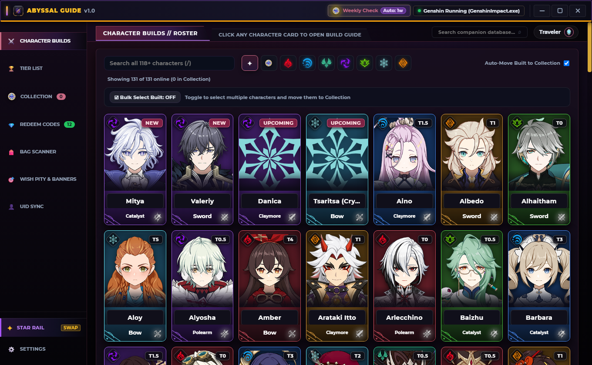
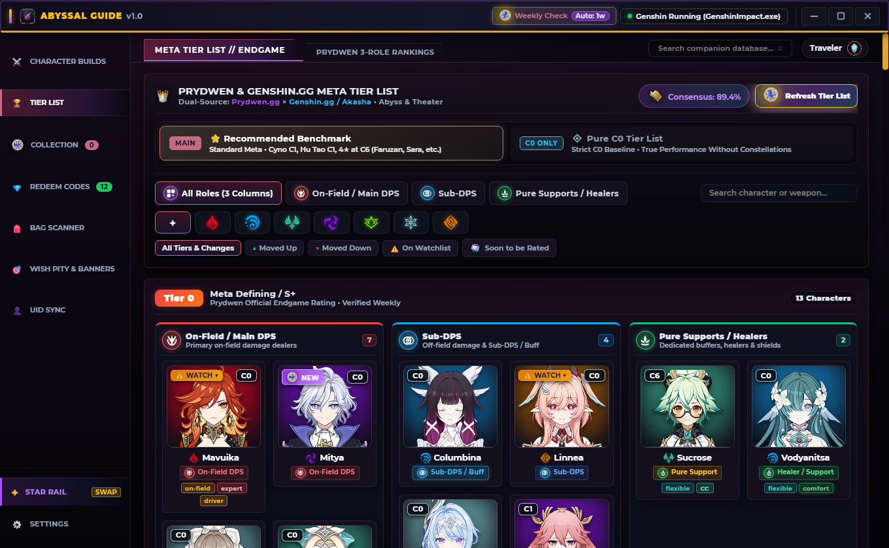
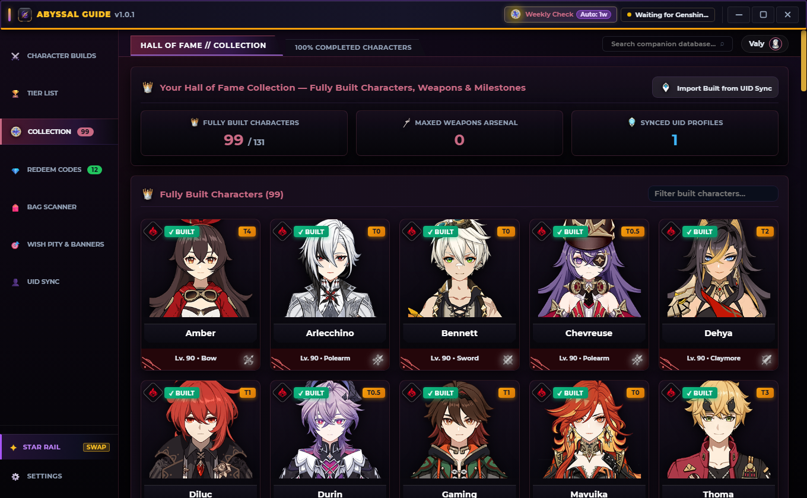
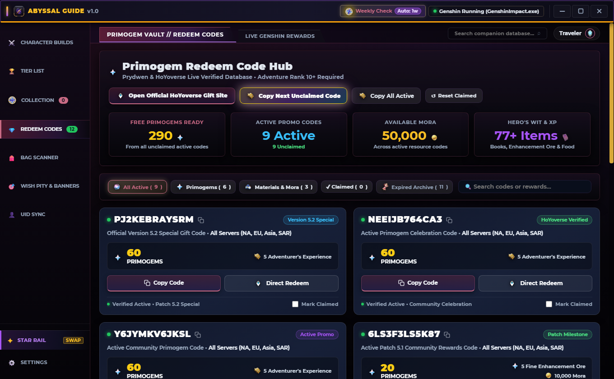
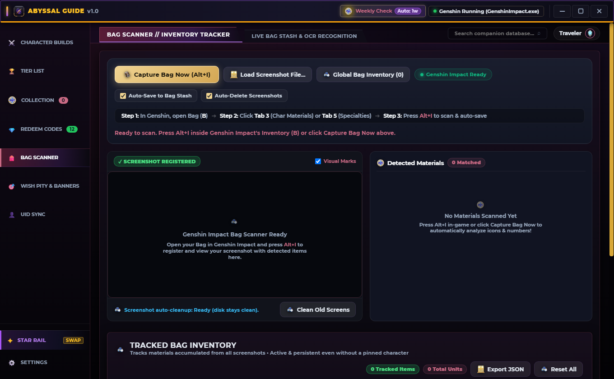
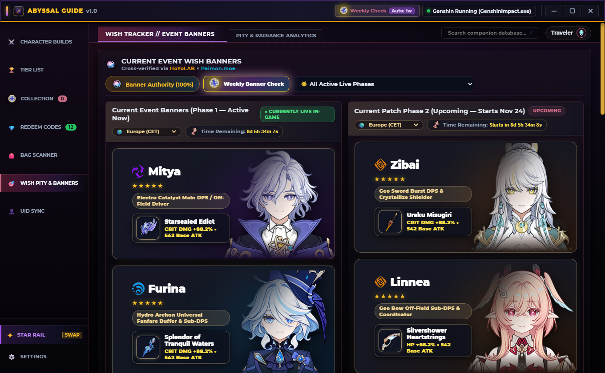
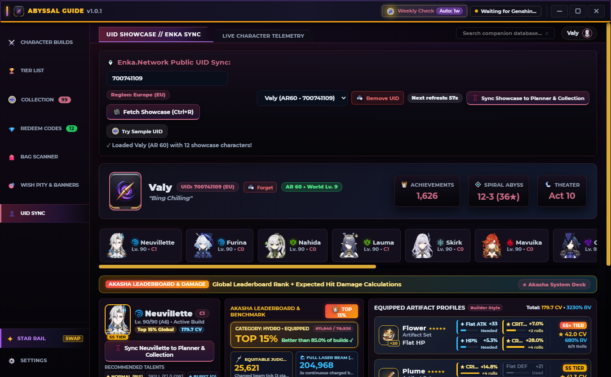

# Genshin Impact Tabs

[&larr; Back to Abyssal Guide](../README.md) &nbsp;&middot;&nbsp; [View Honkai: Star Rail Tabs](hsr-tabs.md)

---

### 1. Character Builds &amp; Roster
Weapons, artifacts, main stats, substat priority, talent goals, and team comps for all characters.

---

### 2. Tier List
Live endgame rankings across all roles, updated from Prydwen.

---

### 3. Collection
Track your finished characters, levels, builds, and maxed weapons in one place.

---

### 4. Redeem Codes
Active Primogem and resource codes with one-click copy, claim tracking, and direct redeem.

---

### 5. Bag Scanner
Scan your in-game inventory (`Alt+I`) with built-in Windows OCR to auto-fill materials.

---

### 6. Wish Pity &amp; Banners
Live current &amp; upcoming banner timers plus automatic full Wish History &amp; 50/50 tracking.

---

### 7. UID Sync
Load your public Enka.Network showcase, Abyss/Theater stats, and Akasha leaderboard rank from your UID.

---

[&larr; Back to Abyssal Guide](../README.md)
