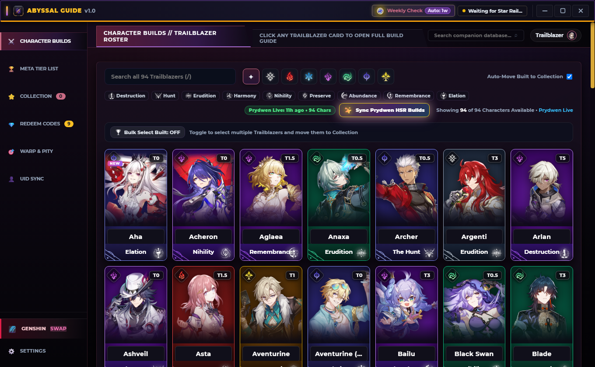
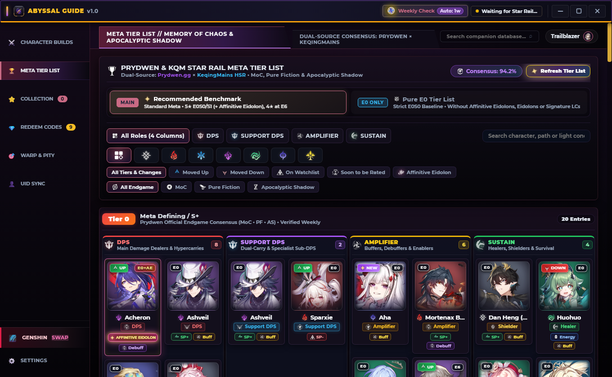
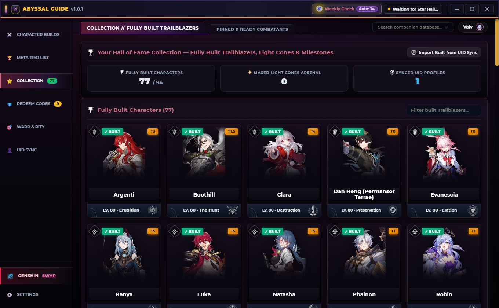
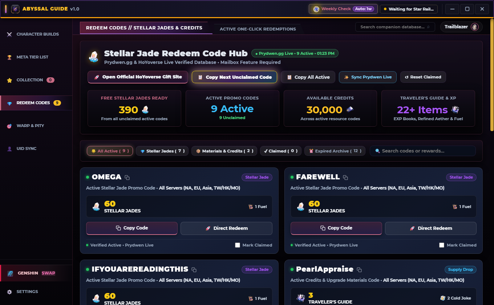
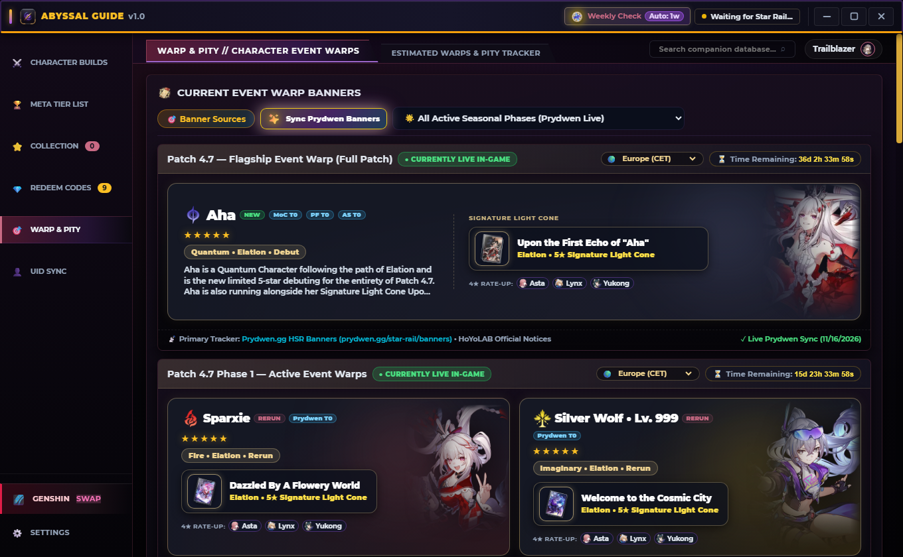
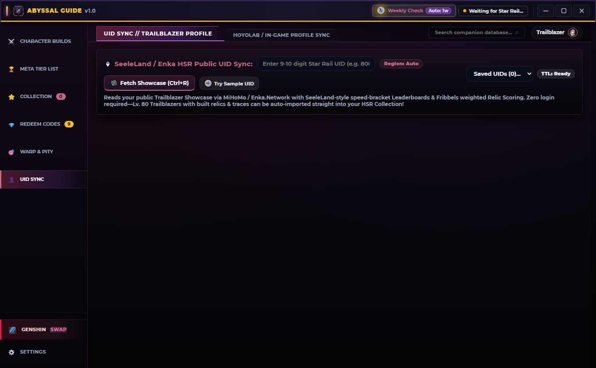

# Honkai: Star Rail Tabs

[&larr; Back to Abyssal Guide](../README.md) &nbsp;&middot;&nbsp; [View Genshin Impact Tabs](genshin-tabs.md)

---

### 1. Character Builds &amp; Roster
Light Cones, Relics, Planar Ornaments, trace priorities, and team comps synced with Prydwen.

---

### 2. Meta Tier List
Memory of Chaos, Pure Fiction, and Apocalyptic Shadow rankings in one view.

---

### 3. Collection
Track your fully built Trailblazers and maxed Light Cones cleanly.

---

### 4. Redeem Codes
Active Stellar Jade and Credit codes with one-click copy and live Prydwen sync.

---

### 5. Warp &amp; Pity
Live event warp banners, timers, and automatic Warp history &amp; pity tracking.

---

### 6. UID Sync
Import your Trailblazer showcase, SeeleLand global leaderboard rank, and Fribbels relic scores.

---

[&larr; Back to Abyssal Guide](../README.md)
